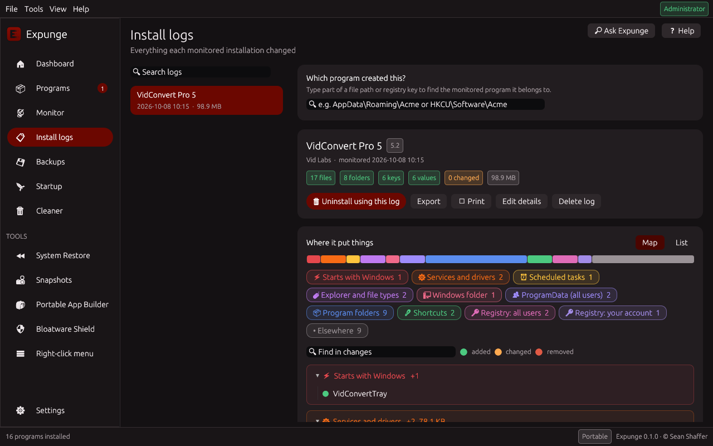
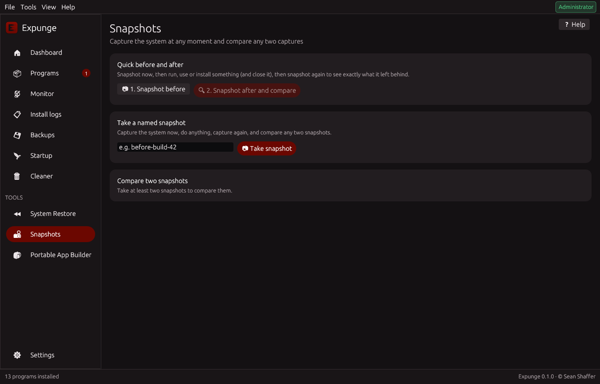
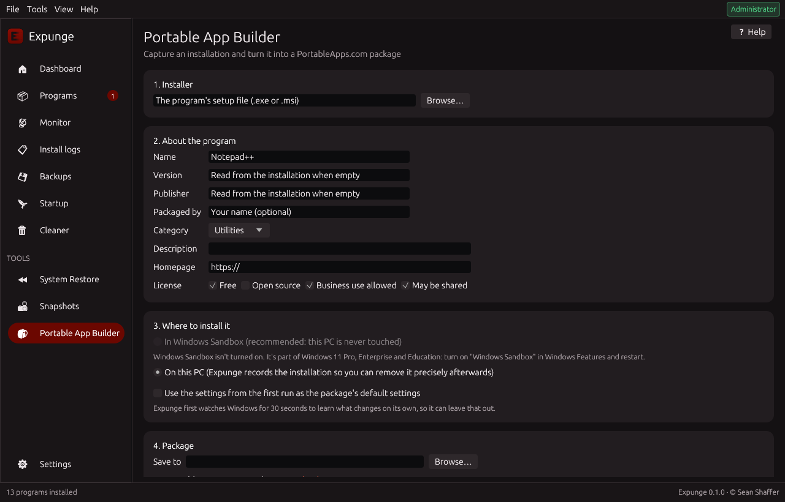
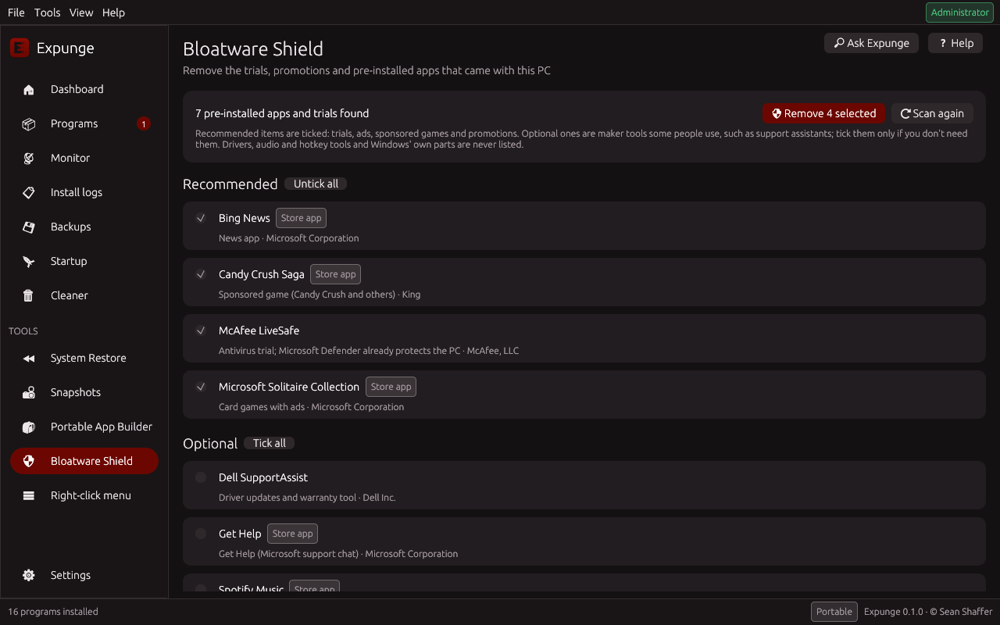
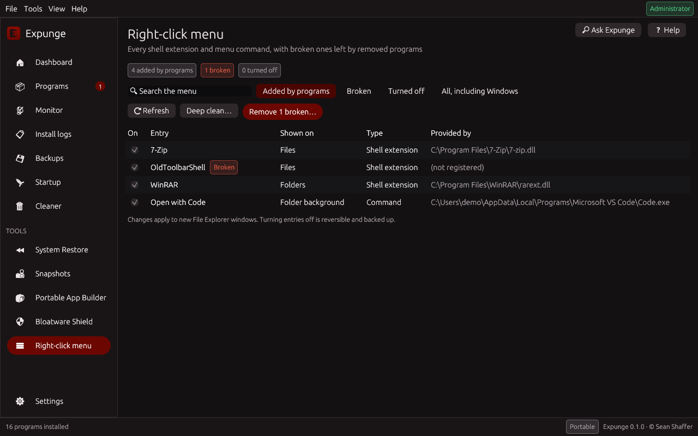

<p align="center">
  
</p>

<p align="center">
  <b>A free, open-source replacement for Total Uninstall, built for Windows 11</b><br>
  Record exactly what an installation changes, then remove exactly that, and nothing else.
</p>

<p align="center">
  <a href="https://github.com/SeanShaffer88/Expunge/releases/latest"></a>
  <a href="https://github.com/SeanShaffer88/Expunge/actions/workflows/ci.yml"></a>
  <a href="LICENSE"></a>
  
</p>

<p align="center">
  <a href="#overview">Overview</a> •
  <a href="#everything-total-uninstall-does-and-more">Feature comparison</a> •
  <a href="#the-tools">The tools</a> •
  <a href="#download">Download</a> •
  <a href="#getting-started">Getting started</a> •
  <a href="#command-line">Command line</a>
</p>

---

## Overview

Most uninstallers run the vendor's own uninstaller and then *guess* at what was left behind. Snapshot tools such as Regshot show a before-and-after comparison, but stop there.

**Expunge closes that gap.** It takes a snapshot of the system before and after an installation and records every file, folder, registry key and value, service, and scheduled task that changed. Later, it turns that record into a precise, reviewable removal plan. Everything Expunge deletes or changes is backed up first, so it can be undone.

Expunge does everything [Total Uninstall](https://www.martau.com/) does, from install monitoring and complete uninstallation to the cleaner, the autorun manager, snapshots, profiles and moving programs to another PC, and it is free for everyone under the GPLv3. It also adds tools of its own: a **map of where every installation put things**, **confidence colours** on every leftover, a **pre-install check** for adware with an optional test run in Windows Sandbox, **silent installers** made from any recorded installation, **Ask Expunge** for questions in plain language, **usage tracking** that finds the programs you never open, suggestions of **lightweight alternatives** installable through winget or Scoop, a **right-click menu manager**, a one-click **Bloatware Shield**, a **System Restore manager** and a **Portable App Builder** that turns any installer into a PortableApps.com package.

## Everything Total Uninstall does, and more

Total Uninstall's features, as listed on its website, and where to find each one in Expunge:

| Total Uninstall feature | In Expunge |
|---|---|
| Analyze installed programs | Programs page: details, signature, size, and a deep leftover scan |
| Add a program to the list for analysis | Programs > **Add program…** (any folder, such as a portable program) |
| Complete uninstall | Programs page: precise removal for monitored programs, deep leftover scan for the rest, batch and silent uninstalls |
| Monitor installations | Monitor page, **Install with Expunge** in the right-click menu, and optional background monitoring |
| Agent that notices running installers | Background monitoring, which records new installations automatically (Settings, Advanced mode) |
| Compare system snapshots | Snapshots page |
| Search in detected changes | Install logs: search across every log |
| Group programs in folders | Install logs: groups and tags |
| Merge installation logs | Install logs > **Merge with** |
| Custom profiles | Monitoring profiles (Settings, Monitor and Snapshots pages) |
| Export detected changes, XML export, registry export, print | Install logs > Export (HTML, XML, `.reg`, PowerShell, JSON) and **Print** |
| Export program lists | File > Export program list (CSV) |
| Backup and restore of uninstalled programs | Backups page: every removal can be restored |
| Transfer programs to another PC | Programs > **Transfer to another PC** |
| Cleaner | Cleaner page, with browser privacy cleaning, scheduled cleaning and deep cleanup |
| Autorun manager | Startup page, with startup impact, delayed start, services, tasks and other autostarts |
| Command line | Full command line (`expunge --help`) |
| Portable version | Portable download, for x64 and Arm64 |

And what only Expunge has:

| Only in Expunge | Where |
|---|---|
| Visual map of what an installation changed, grouped by where it went (startup, services, Explorer, Windows folders, AppData, registry…) | Install logs, Monitor and Snapshots: **Map** |
| Confidence colours on leftovers: green (safe), yellow (review), red (careful), each with its reasons | Every removal review: **Select only green** |
| Pre-install check for bundled adware, offer screens, coin miners, web installers and unsigned or tampered files | Monitor page, before an installer runs |
| Test an installer in Windows Sandbox first and see everything it would change | Monitor page: **Test in Windows Sandbox first** |
| Silent installer (`Setup.exe`) made from a recorded installation, for redeploying without the setup wizard | Install logs > Export > **Silent installer** |
| Questions in plain language ("top 5 space-wasters I haven't opened in 6 months") | **Ask Expunge** (Ctrl+K) |
| When each program was last used, how often, its CPU use and startup cost | Program details, **Not used for 6 months** view, Dashboard |
| Lightweight and open-source alternatives, installed with one click through winget or Scoop | Program details and after an uninstall |
| Right-click menu manager: turn entries off, remove broken ones, deep clean of COM classes and environment entries | **Right-click menu** page |
| One-click removal of OEM bloatware, trials and pre-installed Store apps, also for new user accounts | **Bloatware Shield** page |
| System Restore manager | System Restore page |
| Portable App Builder with a portability check and the PortableApps.com Launcher built in | Portable App Builder page |
| Free and open source (GPLv3) | |

## The tools

Expunge is organized into pages, each with its own job. Every page has built-in help (the **Help** button or **F1**), and anything that could harm Windows or slow the PC appears only in **Advanced mode**.

### Dashboard


Your system at a glance.

- **Summary tiles:** installed programs, monitored programs, broken entries, and backups (with the space they use). Click a tile to jump straight to it.
- **Quick actions:** install a program with monitoring, uninstall programs, speed up startup, clean junk files, System Restore, make a portable app, remove bloatware, and find leftovers of removed programs (Advanced mode).
- **Space-wasters you don't use:** the five largest programs that haven't been opened in six months, ready to review and uninstall.
- **Recently monitored:** the latest install logs, one click away.

### Programs (uninstaller)


Every installed program, and the safest way to remove it.

- **Complete program list:** 64-bit, 32-bit, and per-user desktop programs with their icons, plus Microsoft Store apps. Search, sort by name, publisher, version, date, or size, and filter by *Monitored*, *Broken*, *Unsigned*, or *Store apps*.
- **Add a program by hand:** list a program Windows doesn't know about, such as a portable program, by choosing its folder. Expunge can then analyze it and remove it with everything it left behind.
- **Program details:** publisher, version, install date, size, location, digital signature, uninstaller, and registry key, with buttons to open its folder, open its registry key, search online, or visit its website.
- **Precise uninstallation of monitored programs:** added files, folders, registry keys, and values are deleted; values the installer changed or removed are **restored**; services are stopped and deleted; scheduled tasks are removed; and only the `PATH` entries the installer added are taken out.
- **Classic uninstallation with a deep leftover scan:** after the vendor's uninstaller finishes, Expunge looks for remaining folders, shortcuts, registry keys, autostart entries, App Paths, services, COM registrations, file types and associations, context-menu entries, shell extensions, environment variables, `PATH` entries, firewall rules, scheduled tasks, and folders left empty. Every item is labeled *Safe*, *Review*, or *Careful* before anything is removed.
- **Unattended batch uninstallation:** tick any number of programs and walk away. Silent switches are detected for each installer technology (Windows Installer, Inno Setup, NSIS, WiX, and Squirrel); uninstallers run one at a time; restarts are held until the end; stalled uninstallers are skipped; and one combined leftover scan follows.
- **Silent uninstallation** of a single program, and **forced removal** (Advanced mode) when a program's uninstaller is broken or missing.
- **Trust information:** who digitally signed each program, with unsigned programs and broken signatures (possible tampering) flagged.
- **Usage:** when each program was last opened and how often (from Windows' own records, kept on this PC), how much processor time it uses while running, and how long it adds to each Windows startup. The **Not used for 6 months** view lists what you could do without.
- **Lightweight alternatives:** for heavy or ad-supported programs, free alternatives that do the same job (for example 7-Zip for WinRAR, SumatraPDF for Adobe Reader, VLC for RealPlayer or PowerDVD), installed with one click through winget or Scoop when you choose. They are suggested again right after an uninstall.
- **Confidence colours** in every removal review: green items are safe to remove, yellow ones deserve a look, red ones touch shared parts of Windows. Each colour comes with its reasons, and **Select only green** ticks just the certain ones.
- **Locked files** are scheduled for deletion at the next restart, and **user data is respected**: files a program created later are kept unless you choose otherwise.
- **Transfer to another PC:** pack programs with their files, settings, and registry entries into one file and restore them on a new PC, with a compatibility check, path rewriting for different user names or drives, and one-click undo.
- **Export the program list** as a CSV file.

### Monitor (install monitoring)

Record an installation so it can be removed precisely later.

- **Install and monitor:** choose an installer, or right-click it in File Explorer and select **Install with Expunge**. Expunge takes a snapshot, runs the installer, and records every change.
- **Pre-install check:** before anything runs, the setup file is checked for bundled adware (OpenCandy, InstallCore and others), offer screens, coin miners, web installers that download more while they run, missing or broken digital signatures, and download-site wrappers. Each finding is explained in plain words.
- **Test in Windows Sandbox first** (Windows 11 Pro, Enterprise and Education): the installer runs in a throwaway copy of Windows and Expunge shows everything it would change, on a map, without touching your PC.
- **Manual monitoring** for anything else, including Microsoft Store apps, winget packages, scripts, and portable applications.
- **Live activity:** files being added, changed, and removed stream in while the installer runs, and registry areas report when something under them changes.
- **Restart-safe:** monitoring survives restarts, so installers that need a reboot are captured completely.
- **Review before saving:** inspect every captured change and discard background noise with one click.
- **Automatic detection** of the program's name, publisher, and version.
- **Automatic exclusions:** temporary files, logs, and browser and application caches are ignored, so each log contains only the installer's real changes. **Learn background noise** (Settings) finds what your PC changes on its own and excludes that too.
- **Monitoring profiles:** save scopes under a name, for example a quick one for Program Files only and a deep one for the whole system, and switch between them before monitoring.
- **Background auto-monitoring** (Advanced mode, optional): a low-priority process started at sign-in records installations automatically, even the ones you forgot to monitor.

### Install logs

Everything each monitored installation changed.

- **Complete records** of added, changed, and removed files, folders, registry keys and values, services, and scheduled tasks.
- **A map of where it put things:** changes grouped by what they mean (starts with Windows, services and drivers, scheduled tasks, Explorer and file types, Windows folders, program folders, AppData, shortcuts, registry) with a proportional overview bar. Click an area to focus on it, expand folders and keys like a tree, or switch to the classic list.



- **Groups and tags:** organize logs into groups and label them with tags; search and filter by either.
- **"Which program created this?":** type part of any file or registry path to find the monitored program it belongs to.
- **Merge logs:** combine a program and its update or plugins into one log. Later changes win, and the originals are kept.
- **Export** a log as an HTML report, XML, a `.reg` undo script, a PowerShell removal script, JSON for import on another PC, or **PortableApps.com Launcher settings**. **Print** opens a print-ready report.
- **Silent installer:** turn a recorded installation into a `Setup.exe` that installs exactly that version again without any wizard, plus a folder with the files, `install.reg`, `install.ps1` and `uninstall.ps1`, for redeploying to other PCs.
- **Uninstall from the log** with the same precise removal as the Programs page.

### Backups

Undo any removal, cleanup, or startup change.

- **Automatic backups** of everything Expunge removes or changes. Files go to a quarantine folder, and registry entries are also exported to a timestamped `.reg` file that can be restored with a double-click, even without Expunge.
- **One-click restore** of any operation, putting everything back exactly where it was.
- **Optional extras:** a System Restore point before uninstalling, and copies of removed files in the Recycle Bin.

### Startup (autorun manager)


Choose what starts with Windows.

- **Startup programs** from Run keys and Startup folders, turned on and off exactly like Task Manager does, so the change is reversible.
- **Startup impact:** how long the last Windows startup took and how much each program slowed it down (High, Medium, or Low), measured by Windows itself.
- **Delayed start:** start a program two minutes after you sign in instead of immediately, so Windows is ready sooner. *Start normally* undoes it exactly.
- **Services and scheduled tasks** (Advanced mode), with Windows' own entries hidden unless you ask for them.
- **Other autostarts** (Advanced mode): Winlogon, Active Setup, program replacements (IFEO), AppInit DLLs, Explorer extensions, icon overlays, browser helper objects, boot-time programs, and WMI subscriptions. Entries whose file is gone are flagged.
- **Protection:** entries that Windows, security software, or hardware need can't be switched off in Simple mode, and deleted entries are backed up.

### Cleaner (junk cleaner)


Free the space taken by temporary files and caches.

- **Junk categories:** your and Windows' temporary files, crash dumps and error reports, system memory dumps, Windows setup and update logs, Delivery Optimization files, Windows Update downloads, shader and thumbnail caches, browser caches, Prefetch data, the font cache, and the Recycle Bin. Each one is explained, and *Scan* shows how much space it uses before anything is deleted.
- **Browser privacy cleaning** (each item off until you tick it): cookies, browsing history, website data, and saved sessions for Chrome, Edge, Brave, Vivaldi, Opera, Firefox, LibreWolf, Waterfox, and Floorp, in every profile. Bookmarks and passwords are never touched.
- **Clean automatically** every day, week, or month through Windows Task Scheduler, even when Expunge is closed.
- **Deep cleanup** (Advanced mode): the previous Windows installation (Windows.old), superseded Windows components, files of turned-off features, and old restore points, using Windows' own tools. Each item is analyzed first and confirmed separately.

### System Restore

Manage Windows' restore points without digging through Control Panel.

- **Every restore point** with its date, description, and type (program installed or removed, Windows update, created manually).
- **Create a restore point** with your own description at any time. Windows normally allows only one a day; Expunge lifts that limit for its own request and puts it back afterwards.
- **Roll Windows back** to any restore point, with a clear explanation of what changes (system files, settings, and programs) and what doesn't (your documents and photos), or open Windows' own System Restore wizard.
- **Advanced mode:** delete individual restore points, turn System Protection on or off, and set how much disk space restore points may use.

### Snapshots



Capture the system at any moment and compare any two captures.

- **Quick before and after:** click once before you run, use, or install something, and once afterwards, to see exactly what it changed or left behind.
- **Named snapshots** saved to disk, so you can compare any two, even days apart.
- **Turn the differences into an install log**, so they can be undone like a monitored installation, or export them as **PortableApps.com Launcher settings** (`[RegistryKeys]`, `[DirectoriesMove]`, `[FilesMove]`, and the matching clean-up sections, with paths written as Launcher variables such as `%APPDATA%`).

### Portable App Builder



Turn a program's installer into a PortableApps.com Format package.

- **Choose the installer** (`.exe` or `.msi`) and describe the program: name, version, publisher, category, description, homepage, and license.
- **Isolated capture in Windows Sandbox** (Windows 11 Pro, Enterprise, and Education): the installation happens in a throwaway copy of Windows, so your PC is never touched. On other editions it runs on your PC and is recorded, so the program can be removed precisely afterwards.
- **Clean results:** Expunge first watches Windows for 30 seconds to learn what changes on its own, then runs the installer (silently for MSI, NSIS, and Inno Setup installers if you like) and lets you start the program once so its first-run settings are captured.
- **A complete package:** the program's files in `App\AppName`, `appinfo.ini`, icons taken from the program, `help.html`, and Launcher settings made from the comparison, with shortcuts, installer bookkeeping, and the program's own folder left out. The settings created on first run can be included as the package's defaults.
- **Portability check:** before you share the package, Expunge tells you what could stop the program from working portably, and adjusts the package where it can:
  - **Java:** programs written in Java that don't bring their own Java runtime are marked as needing Java, so the PortableApps.com Launcher uses jPortable or an installed Java.
  - **.NET:** the .NET Framework is part of Windows 11, but programs built for newer .NET versions need the matching runtime on every PC unless they include it; Expunge names the version.
  - **Visual C++ runtimes** the installer put into Windows are copied next to the program, so the portable version doesn't need the Redistributable.
  - **Things that can't travel:** services, drivers, Explorer extensions and COM components, files written into the Windows folder, and programs that always ask for administrator rights.
  - **64-bit-only programs** are marked as such in the package.
- **Nothing else to install:** Expunge compiles the launcher with the official PortableApps.com Launcher source and the NSIS compiler that comes with it, exactly as the PortableApps.com Launcher Generator does. Release downloads include it; otherwise it is downloaded once from GitHub (about 6 MB) and checked against a pinned SHA-256 fingerprint. The `.paf.exe` installer is built with Expunge's own installer script, which installs packages like PortableApps.com installers do (into the PortableApps folder, keeping your settings on upgrades, with the Platform's `/DESTINATION=` option and silent installs). If the official PortableApps.com Installer is installed, Expunge uses it instead, which is what portableapps.com expects for published apps.
- **Compile again with one click** after editing the Launcher settings.

### Bloatware Shield



Remove what came with the PC but you never asked for.

- **One scan, one click:** antivirus trials, sponsored games, VPN and storage offers, manufacturer welcome and promotion apps from Dell, HP, Lenovo, Acer, ASUS, MSI, Samsung and Dynabook, and the Store apps Windows adds for consumers, including the ones ordinary uninstallers skip.
- **Recommended and optional:** trials, ads and promotions are ticked; maker tools some people use, such as support assistants, are listed but left unticked. Drivers, audio and hotkey tools and Windows' own parts are never listed.
- **Also for new accounts:** stop Windows from installing the removed Store apps for user accounts created later.
- **Reviewed and reversible:** programs are uninstalled one after another and their leftovers go through the usual review, with everything backed up.

### Right-click menu



Tidy the menu that appears when you right-click files, folders, drives and the desktop.

- **Every entry programs added:** shell extensions and menu commands, where each appears, and which file provides it. Windows' own entries are hidden unless you ask for them.
- **Turn entries off** with a checkbox, the way Windows itself does, so nothing is deleted and each one can be turned back on.
- **Broken entries** left by removed programs are flagged and can be removed in one go; they slow File Explorer down and can make it show errors.
- **Deep clean:** also finds COM classes, "Open with" entries, and `PATH` and environment entries that removed programs left anywhere in Windows.

### Ask Expunge

Press **Ctrl+K** (or the **Ask Expunge** button) and ask in your own words: *"find and wipe everything related to that video converter I downloaded last week"*, *"top 5 space-wasters I haven't opened in 6 months"*, *"games installed this year bigger than 10 GB"*. Expunge shows how it understood the question, lists matching programs and install logs as you type, and sends removals through the usual review. It all runs on your PC; nothing is sent anywhere. Questions are understood in English.

### Settings and accessibility

- **Simple and Advanced modes**, chosen on first launch. Simple mode uses plain language and offers only options that cannot harm Windows or slow the PC; Advanced mode shows every tool and technical detail.
- **Safety options:** backups before removal, confirmations, restore points, and Recycle Bin copies (always on in Simple mode).
- **Monitoring scope and profiles:** which registry keys and folders snapshots cover, with exclusions and background-noise learning, saved as named profiles.
- **Explorer integration:** the **Install with Expunge** entry in the right-click menu of installers.
- **Full keyboard access:** a visible focus ring, arrow-key navigation in lists, Esc to close dialogs, and shortcuts for every page (Ctrl+1 to Ctrl+9, Ctrl+Tab, Ctrl+F, Ctrl+K, F5, Delete, and F1).
- **Screen-reader support** for Narrator and NVDA, adjustable text size, and a high-contrast option.
- **Eleven languages:** English, Español, Deutsch, Français, Português (Brasil), Italiano, Polski, Русский, 简体中文, 日本語, and 한국어. Additional languages can be added without recompiling (see [Translating](docs/TRANSLATING.md)).

### Design and distribution

- **Built for Windows 11:** a dark interface with a native red Windows 11 window border, and an administrator check at every launch with a one-click relaunch as administrator.
- **Fast and fluid:** a native GPU-rendered interface; slow work (scans, sizes, signatures, usage) runs in the background so the window never freezes. Pages fade in, and hover and selection animate softly; animations follow Windows' own *Animation effects* setting.
- **No dependencies:** a single native executable, with no .NET, no Visual C++ runtime, and nothing else to download.
- **Installer or portable**, for x64 and Arm64 PCs.
- **Full command line** for scripting and automation.

## Download

Download the latest version from the [Releases page](https://github.com/SeanShaffer88/Expunge/releases/latest).

| File | Description |
|---|---|
| `Expunge-Setup-x.y.z.exe` | Installer: installs to Program Files and adds a Start menu shortcut and an *Installed apps* entry. |
| `Expunge-x.y.z-portable.zip` | Portable: unzip anywhere; all data is stored next to the executable. |
| `Expunge-x.y.z-arm64-portable.zip` | Portable build for Windows 11 on Arm PCs. |

**System requirements:** 64-bit Windows 11 (build 22000 or later), on x64 or Arm64. Expunge is designed exclusively for Windows 11 and will not start on earlier versions of Windows. Administrator rights are required for full functionality; Expunge offers to relaunch itself with elevated rights. The Portable App Builder's sandbox needs the *Windows Sandbox* feature, which is part of Windows 11 Pro, Enterprise, and Education.

## Getting started

1. Select **Monitor → Choose installer…** and pick a setup file. Wait for the "before" snapshot to finish.
2. Install the program as usual. Optionally, run it once so that its first-run settings are captured as well.
3. Click **Finish monitoring**, review the changes, and click **Save install log**.
4. When you want to remove the program, go to **Programs** (or **Install logs**) and click **Uninstall**. Review the plan, then confirm. If you change your mind, use **Backups → Restore**.

To make a portable app instead, open **Portable App Builder**, choose the installer, fill in the program's name, and click **Start**.

## Command line

```
expunge monitor --name "Photo Editor" -- C:\Downloads\setup.exe
expunge logs [--group G] [--tag T] [--json]
expunge revert <log-id> --dry-run
expunge revert <log-id>
expunge export <log-id> xml changes.xml
expunge export <log-id> portable PhotoEditorPortable.ini
expunge repackage <log-id> D:\Deploy\PhotoEditor
expunge merge <log-id> <log-id> --name "Photo Editor"
expunge snapshot before.snap
expunge diff before.snap after.snap --name "Photo Editor"
expunge backups
expunge restore <backup-id>
expunge restore-point create "Before installing drivers"
expunge restore-point list
expunge learn-noise [--seconds N] [--apply]
expunge add-program D:\Tools\PortableEditor
expunge uninstall "Photo Editor" "Old Toolbar" --silent
expunge orphans
expunge clean --dry-run
expunge schedule-clean weekly
expunge startup disable Spotify
expunge transfer export moved.expunge "Photo Editor"
expunge transfer import moved.expunge
expunge portable-build C:\Downloads\setup.exe --name "Photo Editor" --silent --out D:\PortableApps
expunge --help
```

Any command that takes snapshots accepts `--profile NAME` to use a saved monitoring profile.

Installer quality checks in a build pipeline:

```
expunge monitor --name MyApp --no-prompt --json -- dist\MyApp-Setup.exe /S
expunge revert <log-id> --keep-log
expunge check-clean <log-id>            # exits with code 2 if anything was left behind
```

## Building from source

```
git clone https://github.com/SeanShaffer88/Expunge
cd Expunge
cargo build --release
```

Expunge builds with stable Rust on Windows. If Visual Studio is not installed, push to GitHub and let the included Actions workflow build it, or cross-compile from Linux (see `scripts/cross-env.sh`). Releases are built automatically when a `v*` tag is pushed.

The core engine (`src/`, excluding `gui/`) is fully unit-tested against an in-memory registry: `cargo test --lib`. Real installers are also installed, removed, checked, and turned into portable packages on clean Windows runners by the Integration workflow.

## How it works

| Stage | What happens |
|---|---|
| Snapshot | Registry keys and values (raw data of every type) and file metadata are recorded under configurable locations, skipping known Windows noise. |
| Comparison | Added, removed, and changed keys, values, and files are identified, compared case-insensitively as Windows does. |
| Plan | Services and tasks are handled first, then files, then folders (deepest first), then registry deletions, and finally restorations. |
| Execution | Every step is backed up first; protected locations are refused; locked files are scheduled for deletion at restart. |
| Undo | Backups are replayed in reverse order to restore everything. |

## Why you can feel safe using Expunge

A lot of work has gone into making Expunge careful, thorough, and fast. Here is what has been done.

**Every change can be checked and undone**
- Everything Expunge removes or changes is backed up first, and any operation can be restored with one click on the Backups page.
- Registry backups are also saved as standard `.reg` files, so they can be restored by double-clicking, even without Expunge.
- A System Restore point can be created before uninstalling, and the System Restore page lets you create one, or roll back to one, at any time.
- Startup changes work the way Task Manager's do (the entry stays and can be switched back on), and delayed starts can be undone with one click.
- Removed files can also go to the Recycle Bin, and Windows asks before permanently deleting anything too large for it.
- You see a full plan before anything is removed, with every item labeled *Safe*, *Review*, or *Careful*, and you confirm it first. The command line offers `--dry-run` to preview changes.
- The Portable App Builder can install programs inside Windows Sandbox, so nothing on your PC changes at all.

**Built-in protection**
- Critical Windows folders and registry keys are hard-coded as protected and can never be deleted, whatever an install log or scan says.
- Registry entries that belong to Windows itself (its security components, app packages, and Task Scheduler bookkeeping) are recognized and left alone, even if Windows changed them while an installation was being monitored.
- Simple mode hides every option that could harm Windows or slow the PC, and keeps backups and confirmations switched on.
- Startup entries that Windows, security software, or hardware need can't be switched off in Simple mode.
- The junk cleaner only touches well-known temporary and cache locations, never their parent folders, and skips files that are in use.
- Expunge checks at every launch that it is running on Windows 11, and tells you when it needs administrator rights instead of failing silently.

**Private by design**
- Expunge has no telemetry, no accounts, and no ads, and it never sends information about you or your PC anywhere.
- It is open source under the GPLv3, so anyone can read exactly what it does.

**Tested at every step**
- Around 85 automated tests run on every change, on both Windows and Linux, together with static code analysis (Clippy).
- Integration tests install real installers (Windows Installer, NSIS, and Inno Setup) on clean Windows machines, remove them with Expunge, and verify that nothing is left behind; the same installers are also turned into PortableApps.com packages and checked. These tests have already found and fixed real problems before release.
- Performance is measured automatically: snapshot speed and memory, time to open the window, and CPU and memory use while idle, each against a fixed budget; a check fails if any budget is exceeded.
- The Arm64 version is built and checked on every change, and translations are checked automatically for missing placeholders.
- Releases are built by GitHub Actions directly from the public source code, and every download is published with a SHA-256 checksum so you can verify it.

**Fast and light**
- Expunge is a single native program written in Rust, with no runtime to install and no just-in-time compilation, built with full link-time optimization.
- Heavy work (snapshots, scans, signature checks, measurements) runs in the background at low priority, so the window never freezes, and folders are scanned in parallel.
- Results that are expensive to compute are cached, and the window is only redrawn when something changes, so Expunge uses no CPU while it sits idle.
- Background monitoring, when you turn it on, runs at low priority so it never competes with your work.

**Made for everyone**
- Plain-language help on every page, full keyboard access, screen-reader support for Narrator and NVDA, adjustable text size, high contrast, and eleven languages.

## Use with care

Expunge has been extensively tested, both with automated tests and with real installers, but like any software that changes Windows it may still contain bugs. Many safety measures are built in: Simple mode hides anything that could harm Windows or slow the PC, critical folders and registry keys are protected and can never be deleted, every removal item is labeled by risk, and you review and confirm changes before they happen. Even so, please use Expunge with caution, and stay in Simple mode unless you know what you are doing.

If something does go wrong, almost anything Expunge does can be undone. Every file, folder, and registry entry it removes or changes is backed up first and can be put back with one click on the **Backups** page (registry entries are also saved as `.reg` files you can restore without Expunge); startup changes and delayed starts are reversible; and you can create a System Restore point before uninstalling, or at any time from the System Restore page, and roll Windows back to it. The few actions that can't be undone, such as deleting temporary files in the junk cleaner, deleting a restore point, or the deep cleanup of Windows itself, are clearly marked and confirmed separately before they run.

## Roadmap

See [ROADMAP.md](ROADMAP.md). Ideas and pull requests are welcome; see [CONTRIBUTING.md](CONTRIBUTING.md) for guidelines.

## License

Copyright © 2026 Sean Shaffer.

Expunge is free software: you can redistribute it and/or modify it under the terms of the **GNU General Public License, version 3** (or, at your option, any later version). See [LICENSE](LICENSE) for details.

The release downloads include the [PortableApps.com Launcher](https://github.com/PortableApps/Launcher) source and the NSIS compiler distributed with it, under their own licenses (GPLv2 and the zlib/libpng license); they are separate programs that Expunge runs, unchanged.

Total Uninstall is a trademark of its owner. Expunge is an independent project and is not affiliated with Total Uninstall or its developer.
