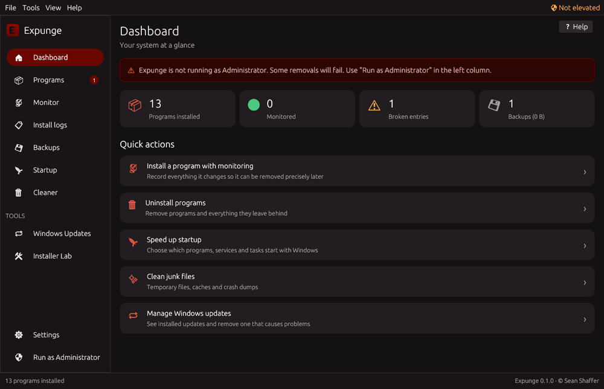
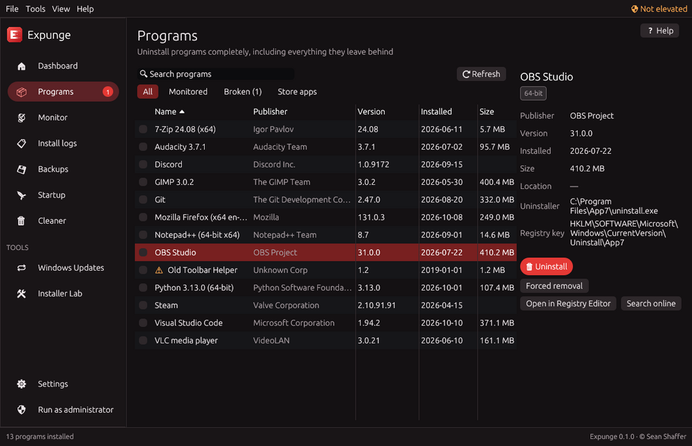

<p align="center">
  
</p>

<p align="center">
  <b>Open Source Install Monitor & Uninstaller</b> for Windows 11.<br>
  Record what an installation changes. Remove exactly that — and nothing else.
</p>

<p align="center">
  <a href="https://github.com/SeanShaffer88/ExpungeUninstaller/releases/latest"></a>
  <a href="https://github.com/SeanShaffer88/ExpungeUninstaller/actions/workflows/ci.yml"></a>
  <a href="LICENSE"></a>
</p>

---

Most uninstallers run the vendor's uninstaller and then *guess* what was left behind. Free tools like Regshot can show you a before/after diff, but stop there.

**Expunge closes that gap.** It snapshots the system before and after an installation, saves the exact list of files, folders, registry keys and values, services and scheduled tasks that changed, and later turns that record into a precise, reversible removal plan. Everything it deletes is backed up first, so every removal can be undone.

It is a free, GPL-licensed alternative to commercial tools like Total Uninstall Pro — friendly enough for someone new to computers, and deep enough for developers testing their own installers.

<p align="center">
  
  
</p>

## Features

**Install monitoring**
- **Install and monitor** — pick an installer, or just right-click it in Explorer → **Install with Expunge**; Expunge snapshots, runs it, and records every change.
- **Manual monitoring** for anything else (Microsoft Store, winget, scripts, portable apps).
- Monitoring **survives restarts**, so installers that need a reboot are captured correctly.
- **Automatic exclusions** ignore temporary files, logs and browser/app caches, so logs contain only the installer's real changes. **Learn background noise** finds what your PC changes on its own and excludes it too.
- Review the capture before saving and drop background noise with one click.
- Detects the program's name, publisher and version automatically.

**Precise uninstall**
- Reverts a monitored installation exactly: deletes added files, folders, keys and values, **restores** values the installer changed or removed, stops and deletes services, removes scheduled tasks.
- **Smart PATH repair** — removes only the entries the installer added to `PATH`, keeping changes you made since.
- Files the program created later (settings, caches) are kept unless you choose to remove them.
- Locked files are scheduled for deletion at the next restart.

**Classic uninstaller (for programs that weren't monitored)**
- Lists desktop programs (64-bit, 32-bit, per-user) with their icons, plus Microsoft Store apps.
- Runs the vendor uninstaller, then scans for leftovers: folders, shortcuts, registry keys, autostart entries, App Paths, services, COM registrations, file types and associations, context-menu entries and shell extensions, environment variables and `PATH` entries, firewall rules, scheduled tasks, and folders left empty.
- **Unattended batch uninstall**: queue any number of programs and walk away. Silent switches are detected per installer type (Windows Installer, Inno Setup, NSIS, WiX, Squirrel), uninstallers run one at a time, restarts are held until the end, stuck ones are skipped, and one combined leftover scan follows.
- **Silent uninstall** for a single program, and **forced removal** when the uninstaller is broken.
- **Broken entry finder** for programs whose uninstaller or folder no longer exists.
- **Leftovers of removed programs**: a system-wide scan for registrations, file types, shell extensions, PATH entries, firewall rules and tasks that point to files that are gone.
- **Trust info**: shows who digitally signed each program, and flags unsigned programs and broken signatures (possible tampering).
- Real folder sizes for programs that don't report one.

**Safety first**
- Automatic **backups** of everything removed or changed — files go to a quarantine folder and registry entries are also exported as a timestamped `.reg` file you can double-click to restore. Restore any operation from the Backups page.
- Optionally send removed files to the **Recycle Bin** as well.
- Optional **System Restore point** before uninstalling.
- Hard-coded protection for critical folders and registry keys — they can never be deleted, whatever a log says.

**Tools**
- **Windows Updates** window (Advanced mode): list installed updates and uninstall individual ones (uses DISM, which works for modern cumulative updates; permanent servicing-stack updates are labelled).
- **Startup manager**: Run keys and Startup folders (Task Manager-compatible enable/disable), services, scheduled tasks.
- **Junk cleaner**: temp files, crash dumps, shader caches, Windows Update downloads, browser caches, Recycle Bin.
- **"Which program created this?"** — search any file or registry path across all monitored installs.
- **Export** install logs as an HTML report, a `.reg` undo script, a PowerShell removal script, or JSON (import them on another PC).

**For everyone**
- **Fully keyboard accessible** and screen-reader friendly (Narrator, NVDA): visible focus ring, arrow-key lists, Esc closes dialogs, shortcuts for every page.
- **Simple and Advanced modes**, chosen on first launch. Simple mode uses plain language and only offers options that can't harm Windows or slow the PC; Advanced mode shows every technical detail and tool.
- **Help on every page** (Help button or F1) explaining terms like *snapshot* and *leftover* in everyday words.
- **Safety labels** on every removal item: *Safe*, *Review* or *Careful*.
- **Accessible**: screen-reader support, adjustable text size, high-contrast option, full keyboard shortcuts (Ctrl+1–8 pages, Ctrl+F search, F5 refresh, Delete uninstall, F1 help).

**For developers — Installer Lab**
- **Installer lint**: reviews a recorded installation for packaging mistakes (missing or incomplete uninstall entry, files in System32, per-user data from per-machine installs, PATH edits, autostart, services, scheduled tasks, shell extensions, file associations, firewall rules, changed shared values) with advice for each. Export as Markdown.
- **Uninstaller test**: runs your program's own uninstaller and reports exactly what it left behind or failed to restore — then cleans it up if you want.
- **Snapshot compare**: take named snapshots any time and diff any two.
- **CI-ready CLI**: `lint` and `test-uninstall` commands with exit codes and `--json` output for build pipelines.

**And**
- Dark interface with a native red Windows 11 window border.
- **9 languages**: English, Español, Deutsch, Français, Português (Brasil), Italiano, Русский, 简体中文, 日本語 — add more without recompiling (see [Translating](docs/TRANSLATING.md)).
- Admin check at every launch, with one-click relaunch as Administrator.
- **No dependencies**: a single native exe; no .NET, no Visual C++ runtime, nothing to download.
- Installer **or** portable mode.
- Full **command line** for scripting.

## Download

Get the latest version from the [Releases page](https://github.com/SeanShaffer88/ExpungeUninstaller/releases/latest):

| File | What it is |
|---|---|
| `Expunge-Setup-x.y.z.exe` | Installer: Program Files, Start menu, Apps & features entry |
| `Expunge-x.y.z-portable.zip` | Portable: unzip anywhere; data stays next to the exe |

Requirements: Windows 11 (or Windows 10), 64-bit. Run as Administrator for full functionality — Expunge offers to relaunch itself elevated.

## How to use it

1. **Monitor → Choose installer…** and pick a setup file. Wait for the "before" snapshot.
2. Install the program normally (run it once if you like, so first-run settings are captured too).
3. Click **Finish monitoring**, review the changes, and **Save install log**.
4. Later: **Programs** (or **Install logs**) → **Uninstall**. Review the plan and remove. Changed your mind? **Backups → Restore**.

## Command line

```
expunge monitor --name "Photo Editor" -- C:\Downloads\setup.exe
expunge logs
expunge revert <log-id> --dry-run
expunge revert <log-id>
expunge export <log-id> reg undo.reg
expunge backups
expunge restore <backup-id>
expunge learn-noise [--seconds N] [--apply]
expunge orphans
expunge --help
```

Installer QA in a build pipeline:

```
expunge monitor --name MyApp --no-prompt --json -- dist\MyApp-Setup.exe /S
expunge lint <log-id> --strict          # exit 2 on errors/warnings
expunge test-uninstall <log-id> --quiet # exit 2 if anything was left behind
```

## Building from source

```
git clone https://github.com/SeanShaffer88/ExpungeUninstaller
cd ExpungeUninstaller
cargo build --release
```

Builds with Rust (stable) on Windows. **No Visual Studio on your PC?** Push to GitHub and let the included Actions workflow build it, or cross-compile from Linux (see `scripts/cross-env.sh`). Releases are built automatically when a `v*` tag is pushed.

The engine (`src/` minus `gui/`) is platform-independent and fully unit-tested with an in-memory registry: `cargo test --lib`.

## How it works

| Step | What happens |
|---|---|
| Snapshot | Registry keys and values (raw data, every type) and file metadata under configurable roots, skipping known Windows noise |
| Diff | Added/removed/changed keys, values and files, compared case-insensitively like Windows |
| Plan | Services and tasks first, then files, folders (deepest first), registry deletions, then restores |
| Execute | Every step is backed up first; protected locations are refused; locked files go to delete-on-reboot |
| Undo | Backups replay in reverse to put everything back |

## Roadmap

See [ROADMAP.md](ROADMAP.md). Ideas and pull requests are welcome — see [CONTRIBUTING.md](CONTRIBUTING.md).

## License

Copyright © 2026 Sean Shaffer.

Expunge is free software: you can redistribute it and/or modify it under the terms of the **GNU General Public License v3** (or any later version). See [LICENSE](LICENSE).
