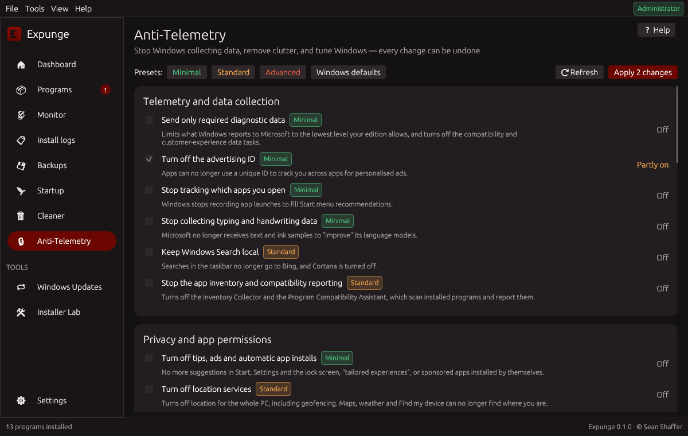
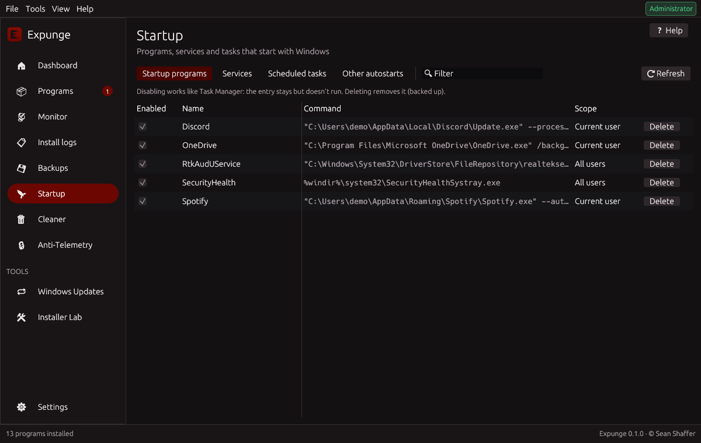
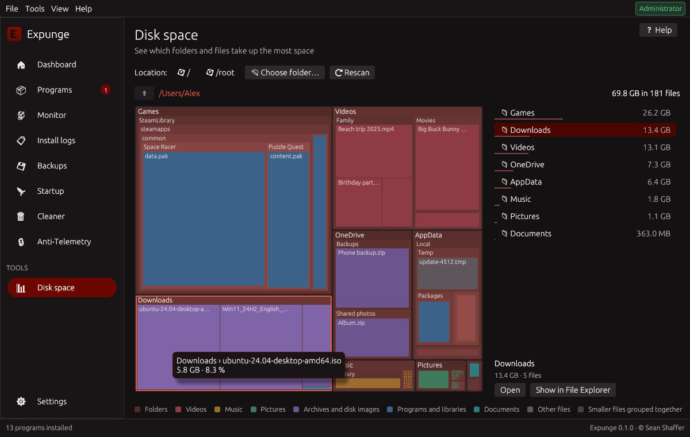
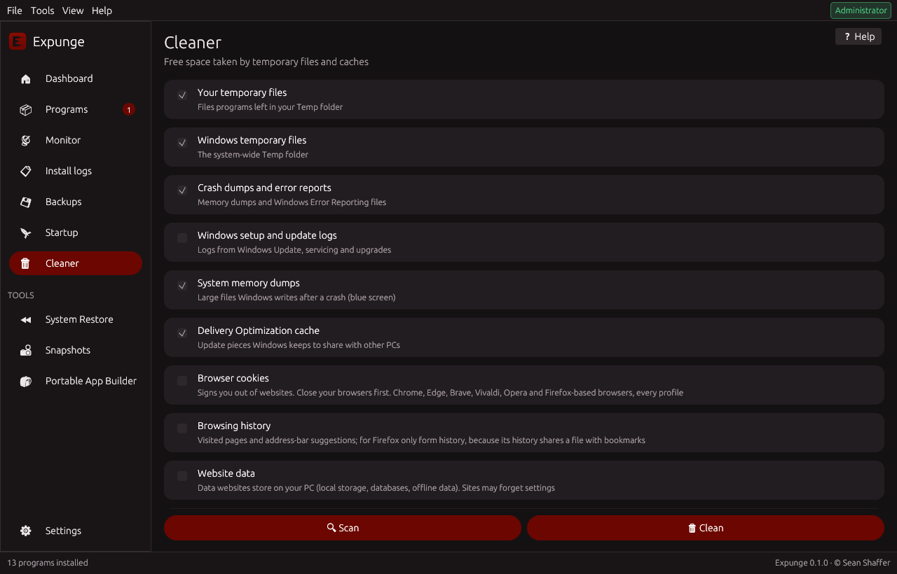

<p align="center">
  
</p>

<p align="center">
  <b>Open-source install monitor, uninstaller, and privacy toolkit for Windows 11</b><br>
  Record exactly what an installation changes, then remove exactly that, and nothing else.
</p>

<p align="center">
  <a href="https://github.com/SeanShaffer88/ExpungeUninstaller/releases/latest"></a>
  <a href="https://github.com/SeanShaffer88/ExpungeUninstaller/actions/workflows/ci.yml"></a>
  <a href="LICENSE"></a>
  
</p>

<p align="center">
  <a href="#showcase">Showcase</a> •
  <a href="#features">Features</a> •
  <a href="#download">Download</a> •
  <a href="#getting-started">Getting started</a> •
  <a href="#command-line">Command line</a> •
  <a href="#building-from-source">Building</a>
</p>

---

## Overview

Most uninstallers run the vendor's own uninstaller and then *guess* at what was left behind. Snapshot tools such as Regshot can show a before-and-after comparison, but they stop there.

**Expunge closes that gap.** It takes a snapshot of the system before and after an installation and records every file, folder, registry key and value, service, and scheduled task that changed. Later, it turns that record into a precise, reviewable removal plan. Everything Expunge deletes or modifies is backed up first, so every operation can be undone.

Beyond uninstalling, Expunge brings together the tools needed to keep Windows 11 lean and private: a startup manager, a disk space map, a duplicate file finder, a junk cleaner, a debloater, and an Anti-Telemetry page with reversible privacy settings.

Expunge is a free, GPL-licensed alternative to commercial tools such as Total Uninstall Pro. It is approachable enough for someone new to computers and thorough enough for developers testing their own installers.

## Showcase

<table>
  <tr>
    <td width="50%"><br><b>Dashboard</b>: an overview of installed programs, monitored installations, broken entries, and backups, with one-click access to common tasks.</td>
    <td width="50%"><br><b>Programs</b>: every installed desktop program and Store app, with sizes, available updates, signature status, and full details for the selected program.</td>
  </tr>
  <tr>
    <td width="50%"><br><b>Anti-Telemetry</b>: privacy and debloating settings grouped by category, with Minimal, Standard, and Advanced presets and exact undo.</td>
    <td width="50%"><br><b>Startup manager</b>: startup programs, services, scheduled tasks, and every other autostart location in one place.</td>
  </tr>
  <tr>
    <td width="50%"><br><b>Disk space map</b>: a treemap of any drive or folder, colored by file type, showing exactly where the space goes.</td>
    <td width="50%"><br><b>Junk cleaner</b>: temporary files, crash dumps, logs, and caches, with an explanation of each category.</td>
  </tr>
</table>

## Features

### Install monitoring
- **Install and monitor:** choose an installer, or right-click it in File Explorer and select **Install with Expunge**. Expunge takes a snapshot, runs the installer, and records every change.
- **Manual monitoring** for anything else, including Microsoft Store apps, winget packages, scripts, and portable applications.
- **Restart-safe:** monitoring continues across restarts, so installers that require a reboot are captured completely.
- **Automatic exclusions:** temporary files, logs, and browser and application caches are ignored, so each log contains only the installer's real changes.
- **Background-noise learning:** Expunge observes what your PC changes on its own and offers to exclude it from future captures.
- **Groups and tags:** organize install logs into groups and label them with tags; search and filter by either.
- **Review before saving:** inspect every captured change and discard background noise with one click.
- **Automatic detection** of the program's name, publisher, and version.

### Precise uninstallation
- **Exact reversal** of a monitored installation: added files, folders, registry keys, and values are deleted; values the installer changed or removed are **restored**; services are stopped and deleted; and scheduled tasks are removed.
- **Smart PATH repair:** only the entries the installer added to `PATH` are removed; changes you made afterward are preserved.
- **User data is respected:** files the program created later, such as settings and caches, are kept unless you choose to remove them.
- **Locked files** are scheduled for deletion at the next restart.

### Classic uninstaller
For programs that were installed without monitoring:
- **Complete program list:** 64-bit, 32-bit, and per-user desktop programs with their icons, plus Microsoft Store apps.
- **Deep leftover scan:** after the vendor's uninstaller finishes, Expunge searches for remaining folders, shortcuts, registry keys, autostart entries, App Paths, services, COM registrations, file types and associations, context-menu entries, shell extensions, environment variables, `PATH` entries, firewall rules, scheduled tasks, and folders left empty.
- **Unattended batch uninstallation:** queue any number of programs and walk away. Silent switches are detected for each installer technology (Windows Installer, Inno Setup, NSIS, WiX, and Squirrel); uninstallers run one at a time; restarts are deferred until the end; stalled uninstallers are skipped; and a single combined leftover scan follows.
- **Silent uninstallation** for individual programs, and **forced removal** when a program's uninstaller is broken or missing.
- **Broken-entry finder** for programs whose uninstaller or installation folder no longer exists.
- **Orphan scan:** a system-wide search for registrations, file types, shell extensions, `PATH` entries, firewall rules, and tasks that point to files that no longer exist.
- **Trust information:** shows who digitally signed each program, and flags unsigned programs and invalid signatures that may indicate tampering.
- **Accurate sizes** for programs that do not report their own.
- **Updates through winget:** see which programs have newer versions and update one or all of them silently.

### Anti-Telemetry and debloating
- **Telemetry and data collection:** limit diagnostic data to the minimum, turn off the advertising ID, app-launch tracking, typing and handwriting data collection, cloud search and Cortana, and the inventory and compatibility reporters.
- **Privacy and app permissions:** deny Store apps access to the camera, microphone, location, contacts, calendar, call history, email, and messages; turn off location services; stop background apps; and remove tips, ads, and automatically installed apps.
- **Bloatware and AI features:** remove pre-installed consumer apps (optionally for new user accounts as well), and turn off Windows Copilot and Recall.
- **Explorer and search:** restore the full context menu, open File Explorer to *This PC* with file extensions and hidden files visible, turn off transparency effects, and stop the search indexer.
- **Services:** disable DiagTrack, dmwappushservice, Windows Error Reporting, and, optionally, SysMain.
- **Windows Update control:** defer feature updates by 365 days and quality updates by four days, or pause updates for seven days.
- **Network:** stop automatic connections to open hotspots, and switch to a secure DNS provider (Cloudflare, Quad9, Google, or AdGuard) with one click.
- **Performance and repair:** enable the Ultimate Performance power plan, and run System File Checker, DISM RestoreHealth, a network reset, or winget re-registration.
- **Built-in safeguards:** Minimal, Standard, and Advanced presets; a restore point before every change; and a record of every previous value, so each setting can be reversed exactly.

### System tools
- **Startup manager:** Run keys and Startup folders (with Task Manager–compatible enabling and disabling), services and drivers, and scheduled tasks. Advanced mode adds every other autostart location: Winlogon, Active Setup, Image File Execution Options, AppInit DLLs, Explorer extensions, icon overlays, browser helper objects, boot-time programs, and WMI subscriptions.
- **Disk space map:** a treemap of any drive or folder in which each block's size matches the space it uses, colored by file type (videos, music, pictures, archives and disk images, programs, documents). Click any block to look inside it, or use the size-sorted list beside it with the keyboard. Read-only, so it is safe in Simple mode.
- **Duplicate file finder:** finds files with identical contents (compared by SHA-256, not by name) in your personal folders or any folder you choose. Keep the oldest, newest or shortest-path copy automatically, or choose yourself; at least one copy is always kept, and removed copies go to the Recycle Bin. Windows, program and app-data folders are never searched, and cloud-only files are never downloaded.
- **Junk cleaner:** temporary files, crash and memory dumps, Windows logs, Delivery Optimization and Windows Update downloads, shader and browser caches, Prefetch data, and the Recycle Bin, on demand or automatically every day, week, or month.
- **Deep cleanup** (Advanced mode): the previous Windows installation (Windows.old), superseded Windows components, files of disabled features, and old restore points. Each item is analyzed first and confirmed separately.
- **Windows Updates manager** (Advanced mode): list installed updates and uninstall individual ones. Permanent servicing-stack updates are clearly labeled.
- **Windows features and app aliases** (Advanced mode): turn optional Windows features on or off, and see which app execution aliases are active.
- **Program transfer:** package programs together with their files, settings, and registry entries, then restore them on another PC. Includes a compatibility check, automatic path rewriting for different user names or drives, and one-click undo.
- **"Which program created this?":** search for any file or registry path across all monitored installations.
- **Repackaging:** turn a monitored installation into a deployable folder containing a silent `install.ps1`, an `install.reg`, and an `uninstall.ps1`.
- **Export** install logs as an HTML report, a `.reg` undo script, a PowerShell removal script, or JSON for import on another PC.

### Safety
- **Automatic backups** of everything removed or changed. Files are moved to a quarantine folder, and registry entries are also exported to a timestamped `.reg` file that can be restored with a double-click. Any operation can be restored from the Backups page.
- **Optional Recycle Bin copies** of removed files.
- **Optional System Restore point** before uninstalling.
- **Hard-coded protection** for critical folders and registry keys: they can never be deleted, regardless of what a log contains.
- **Safety labels** on every removal item: *Safe*, *Review*, or *Careful*.

### Accessibility and ease of use
- **Simple and Advanced modes**, chosen on first launch. Simple mode uses plain language and offers only options that cannot harm Windows or slow the PC; Advanced mode shows every tool and technical detail.
- **Contextual help** on every page (the Help button or F1), explaining terms such as *snapshot* and *leftover* in everyday language.
- **Full keyboard access:** a visible focus ring, arrow-key navigation in lists, Esc to close dialogs, and shortcuts for every page (Ctrl+1 to Ctrl+9, Ctrl+Tab, Ctrl+F, F5, Delete, and F1).
- **Screen-reader support** for Narrator and NVDA, adjustable text size, and a high-contrast option.

### For developers: Installer Lab
- **Installer lint:** reviews a recorded installation for common packaging mistakes, such as a missing or incomplete uninstall entry, files written to System32, per-user data from per-machine installations, `PATH` edits, autostart entries, services, scheduled tasks, shell extensions, file associations, firewall rules, and changes to shared values. Each finding includes advice, and the report can be exported as Markdown.
- **Uninstaller test:** runs your program's own uninstaller and reports exactly what it left behind or failed to restore, then optionally cleans it up.
- **Snapshot comparison:** take named snapshots at any time and compare any two.
- **CI-ready command line:** `lint` and `test-uninstall` commands with exit codes and `--json` output for build pipelines.

### Design and distribution
- **Built for Windows 11:** a dark interface with a native red Windows 11 window border.
- **Nine languages:** English, Español, Deutsch, Français, Português (Brasil), Italiano, Русский, 简体中文, and 日本語. Additional languages can be added without recompiling (see [Translating](docs/TRANSLATING.md)).
- **Administrator check** at every launch, with a one-click relaunch as administrator.
- **No dependencies:** a single native executable, with no .NET, no Visual C++ runtime, and nothing else to download.
- **Installer or portable:** use whichever suits you.
- **Full command line** for scripting and automation.

## Download

Download the latest version from the [Releases page](https://github.com/SeanShaffer88/ExpungeUninstaller/releases/latest).

| File | Description |
|---|---|
| `Expunge-Setup-x.y.z.exe` | Installer: installs to Program Files and adds a Start menu shortcut and an *Installed apps* entry. |
| `Expunge-x.y.z-portable.zip` | Portable: unzip anywhere; all data is stored next to the executable. |

**System requirements:** 64-bit Windows 11 (build 22000 or later). Expunge is designed exclusively for Windows 11 and will not start on earlier versions of Windows. Administrator rights are required for full functionality; Expunge offers to relaunch itself with elevated rights.

## Getting started

1. Select **Monitor → Choose installer…** and pick a setup file. Wait for the "before" snapshot to finish.
2. Install the program as usual. Optionally, run it once so that its first-run settings are captured as well.
3. Click **Finish monitoring**, review the changes, and click **Save install log**.
4. When you want to remove the program, go to **Programs** (or **Install logs**) and click **Uninstall**. Review the plan, then confirm. If you change your mind, use **Backups → Restore**.

## Command line

```
expunge monitor --name "Photo Editor" -- C:\Downloads\setup.exe
expunge logs
expunge revert <log-id> --dry-run
expunge revert <log-id>
expunge export <log-id> reg undo.reg
expunge backups
expunge restore <backup-id>
expunge learn-noise [--seconds N] [--apply]
expunge orphans
expunge disk C:\Users --top 20
expunge duplicates %USERPROFILE%\Pictures --min-size 1
expunge uninstall "Photo Editor" "Old Toolbar" --silent
expunge clean --dry-run
expunge schedule-clean weekly
expunge startup disable Spotify
expunge updates
expunge update --all
expunge transfer export moved.expunge "Photo Editor"
expunge transfer import moved.expunge
expunge --help
```

Installer quality checks in a build pipeline:

```
expunge monitor --name MyApp --no-prompt --json -- dist\MyApp-Setup.exe /S
expunge lint <log-id> --strict          # exits with code 2 on errors or warnings
expunge test-uninstall <log-id> --quiet # exits with code 2 if anything was left behind
```

## Building from source

```
git clone https://github.com/SeanShaffer88/ExpungeUninstaller
cd ExpungeUninstaller
cargo build --release
```

Expunge builds with stable Rust on Windows. If Visual Studio is not installed, push to GitHub and let the included Actions workflow build it, or cross-compile from Linux (see `scripts/cross-env.sh`). Releases are built automatically when a `v*` tag is pushed.

The core engine (`src/`, excluding `gui/`) is fully unit-tested against an in-memory registry: `cargo test --lib`.

## How it works

| Stage | What happens |
|---|---|
| Snapshot | Registry keys and values (raw data of every type) and file metadata are recorded under configurable locations, skipping known Windows noise. |
| Comparison | Added, removed, and changed keys, values, and files are identified, compared case-insensitively as Windows does. |
| Plan | Services and tasks are handled first, then files, then folders (deepest first), then registry deletions, and finally restorations. |
| Execution | Every step is backed up first; protected locations are refused; locked files are scheduled for deletion at restart. |
| Undo | Backups are replayed in reverse order to restore everything. |

## Roadmap

See [ROADMAP.md](ROADMAP.md). Ideas and pull requests are welcome; see [CONTRIBUTING.md](CONTRIBUTING.md) for guidelines.

## License

Copyright © 2026 Sean Shaffer.

Expunge is free software: you can redistribute it and/or modify it under the terms of the **GNU General Public License, version 3** (or, at your option, any later version). See [LICENSE](LICENSE) for details.
